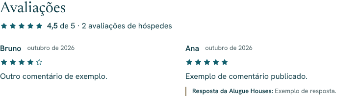
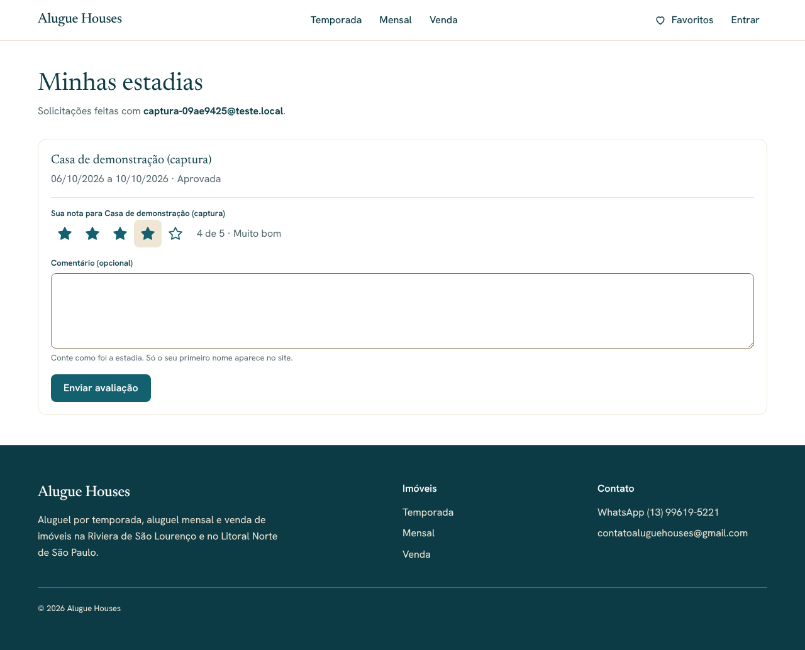

# Alugue Houses — Avaliações moderadas (Etapa 14)

> Status: **aguardando aprovação**.

## Quem avalia

Só hóspedes com **estadia aprovada e já concluída**, entrando pelo link do
e-mail com o **mesmo e-mail da solicitação**. Cada estadia recebe no máximo
uma avaliação. Essas regras ficam no banco (Etapa 4) e são testadas.

## Minhas estadias (`/minhas-estadias`)

- Lista as solicitações feitas com o e-mail da pessoa conectada, com datas e
  situação. Sem login, explica e oferece entrar (volta para a página depois
  do link).
- Estadia concluída e ainda não avaliada: formulário com **nota de 1 a 5
  estrelas** (botões de opção acessíveis, setas do teclado) e comentário
  opcional (até 2.000 caracteres).
- Depois de enviar: "Em análise", com a nota e o comentário. A avaliação não
  pode ser editada. Publicada, mostra também a resposta da Alugue Houses.
- Estadia aprovada ainda por acontecer: "Você poderá avaliar depois do
  check-out".
- Caminhos até a página: "Entrar" (já conectado) mostra "Favoritos" e "Minhas
  estadias"; a confirmação da solicitação de reserva avisa onde avaliar.

## Moderação (`/admin/avaliacoes`)

- Abas **Pendentes** (padrão), **Publicadas** e **Não publicadas**, com
  contador de pendentes no menu e na página inicial do painel.
- Cada avaliação: primeiro nome, imóvel, nota, comentário, data e link para a
  reserva. Ações: **Publicar**, **Não publicar** e **resposta pública**
  (opcional; numa avaliação publicada, "Salvar resposta").
- O admin não altera a nota nem o comentário do hóspede (permissão de coluna
  no banco).

## Página do imóvel

- Seção "Avaliações" só quando há avaliações publicadas: média com uma casa
  decimal ("4,5 de 5"), quantidade e a lista (mais recentes primeiro), com
  primeiro nome, mês/ano, estrelas, comentário e resposta.
- Os dados vêm pelo cliente anônimo: só avaliações publicadas e só colunas
  públicas (sem e-mail, sem autor e sem vínculo com a reserva).

## Correções feitas nesta etapa

- Menu do painel quebra linha no celular (com 4 itens e contadores, passava
  1 px da largura da tela).
- Formulários do painel enviam também o botão clicado (necessário para
  "Publicar" e "Não publicar" no mesmo formulário).

## Fora desta etapa

- Convite por e-mail para avaliar depois do check-out (depende do SMTP).
- Nota com estrelas nos resultados do Google (dados estruturados na
  Etapa 17).

## Testes

- **pgTAP** (`11_moderacao_avaliacoes`): hóspede não escolhe a situação, não
  avalia duas vezes nem edita; admin sem MFA não publica; admin publica e
  responde mas não muda a nota; visitante vê a publicada com resposta.
  Total do banco: 147.
- **Unitários**: média, validação da nota e do comentário, abas. Total: 75.
- **Ponta a ponta** (desktop, tablet e celular): convite para entrar; estadia
  futura sem formulário; nota obrigatória; escolha pelo teclado; "Em análise";
  nada no site antes da moderação; admin publica com resposta (só o primeiro
  nome aparece); média e resposta na página do imóvel; "Não publicar" tira do
  site; outra pessoa não vê as estadias; WCAG 2.1 AA sem rolagem horizontal.
  Total da suíte: 221.

