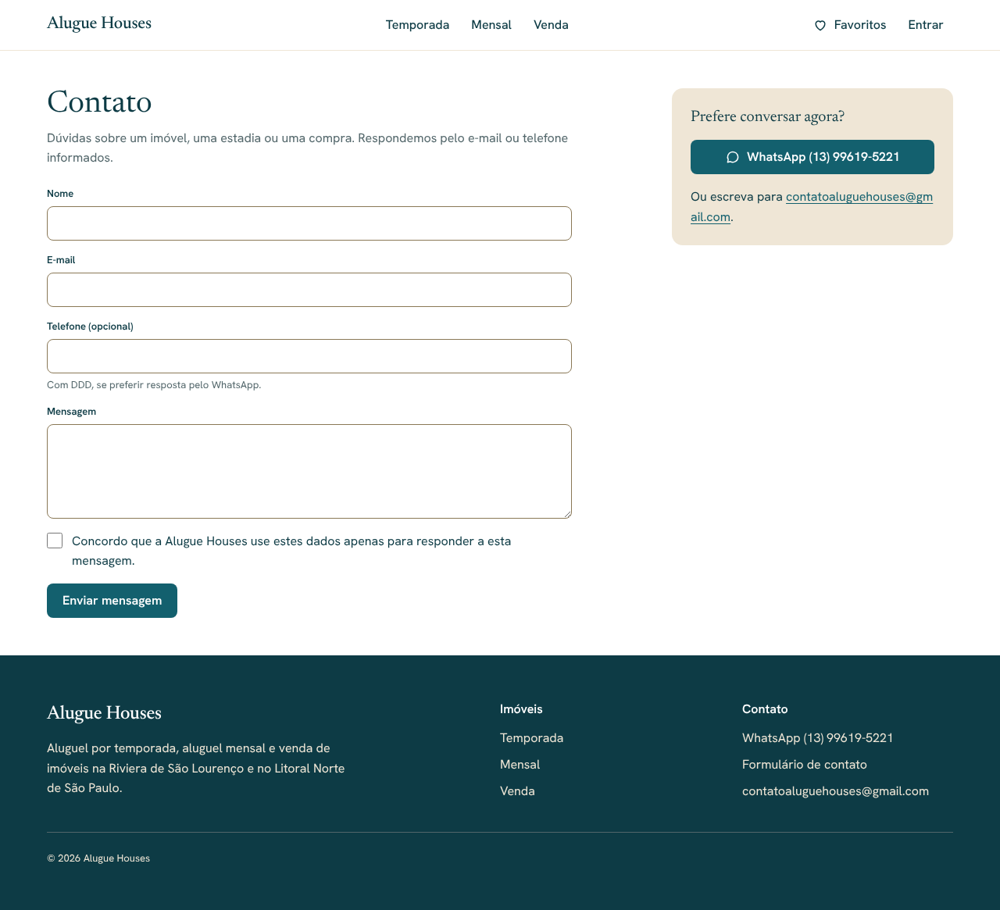
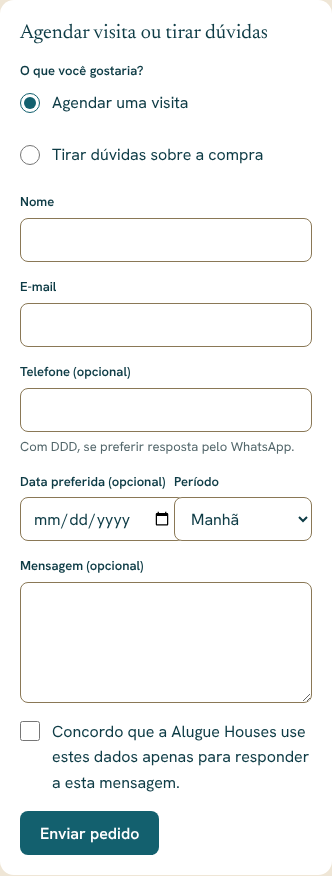

# Alugue Houses — Contato, visitas e avisos por e-mail (Etapa 15)

> Status: **aguardando aprovação**.

## Para o visitante

- **`/contato`**: nome, e-mail, telefone opcional (com DDD), mensagem e
  consentimento (LGPD). WhatsApp e e-mail ao lado. Link no rodapé
  ("Formulário de contato") e no menu do celular ("Contato").
- **Imóvel à venda**: no painel "Valores e contato", formulário "Agendar
  visita ou tirar dúvidas" — escolha entre visita e dúvidas sobre a compra,
  data preferida (a partir de hoje) e período (manhã ou tarde); mensagem
  opcional.
- **Imóvel de aluguel**: link "Enviar uma pergunta por mensagem", que abre o
  contato já indicando o imóvel (`/contato?imovel=…`).
- Mesmo anti-spam da reserva: campo-isca, limite de 5 envios por hora por IP
  e 5 por dia por e-mail (contados à parte da reserva) e Turnstile quando
  configurado. Erros mantêm o que foi digitado; o sucesso é anunciado e
  recebe o foco.

## Avisos por e-mail ao administrador

- Enviados a cada **mensagem nova** (contato, visita, interesse) e a cada
  **nova solicitação de reserva** (com protocolo, imóvel, datas, total e o
  link do painel). O "responder" do e-mail vai direto para o visitante.
- Destino: `ADMIN_NOTIFY_EMAIL` ou, sem ela, `contatoaluguehouses@gmail.com`.
- Ordem de envio: **Resend** (`RESEND_API_KEY`) → **Mailpit** local
  (`MAILPIT_URL`, só desenvolvimento e testes) → desativado com aviso no log.
- A mensagem já está gravada antes do envio: se o e-mail falhar ou demorar
  (limite de 5 s), o visitante não é afetado e o painel continua com tudo.

### Configurar o Resend (antes de publicar)

1. Criar conta em resend.com com o e-mail `contatoaluguehouses@gmail.com`.
2. Criar uma API key com permissão só de envio e cadastrar como segredo do
   Worker: `RESEND_API_KEY`.
3. **Sem domínio próprio** (situação atual, risco R5): o Resend só envia do
   remetente de teste `onboarding@resend.dev` para o e-mail da própria conta
   — suficiente para estes avisos. Deixe `EMAIL_FROM` vazio.
4. **Com domínio** (depois): verificar o domínio no Resend (SPF/DKIM) e
   definir `EMAIL_FROM="Alugue Houses <avisos@seudominio.com.br>"`. Isso
   também será necessário para e-mails a hóspedes.

Nenhuma chave foi criada ou versionada nesta etapa.

## Painel (`/admin/contatos`)

- Abas **Novos** (mais antigos primeiro), **Em andamento** e **Encerrados**,
  com contador de novos no menu e na página inicial do painel.
- Cada mensagem: tipo, data, nome, imóvel, visita preferida, mensagem, e-mail
  (link) e "Responder no WhatsApp" (quando há telefone).
- Mudar a situação move a mensagem de aba e mostra um aviso no topo.

## Segurança

- Gravação só pelo servidor (`service_role`) depois da validação e do
  anti-spam; visitantes e usuários comuns não leem nem gravam a tabela
  (RLS, testado). O admin lê e altera com a própria sessão (MFA).
- O imóvel indicado precisa estar publicado.

## Fora desta etapa

- E-mails a hóspedes e visitantes (confirmações, respostas automáticas):
  exigem domínio verificado.

## Testes

- **pgTAP** (`12_contatos`): visitante e usuário comum não gravam nem leem;
  servidor grava; telefone inválido recusado; admin muda a situação.
  Total do banco: 155.
- **Unitários**: escolha do envio (Resend, Mailpit, desativado, falhas sem
  exceção), validação por tipo (todos os erros de uma vez), data da visita,
  período ↔ horário de São Paulo, abas. Total: 86.
- **Ponta a ponta** (desktop, tablet e celular): contato com validação,
  gravação e **e-mail recebido pelo admin** (destino, responder-para e link do
  painel); pedido de visita com data e período e e-mail; pergunta pelo
  aluguel com o imóvel indicado; **e-mail de nova solicitação de reserva**;
  abas do painel; WCAG 2.1 AA sem rolagem horizontal. Total da suíte: 239.

