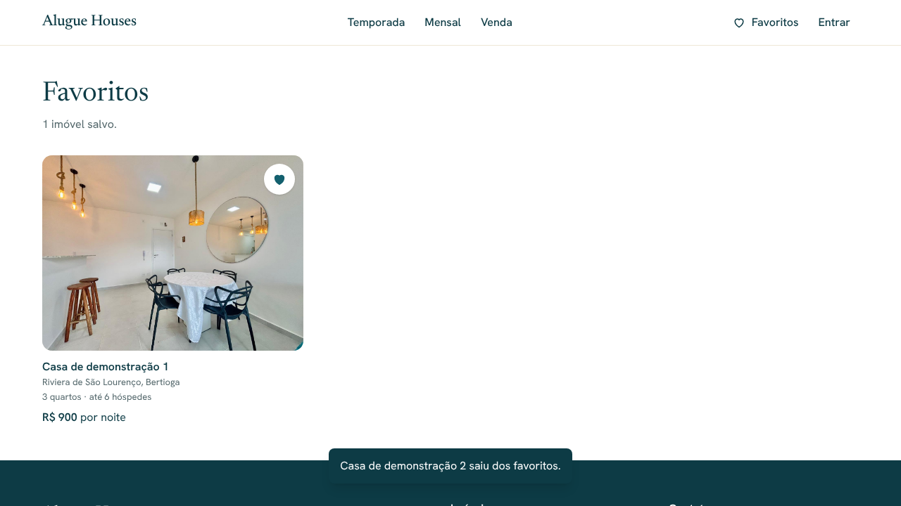
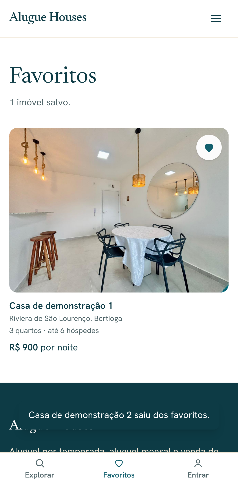

# Alugue Houses — Favoritos (Etapa 13)

> Status: **aguardando aprovação**.

## Como funciona

- **Coração** em todos os cartões de imóvel (página inicial, temporada, mensal,
  venda e favoritos) e botão **Salvar/Salvo** ao lado do título na página do
  imóvel.
- **Com login** (link por e-mail): salva ou remove na hora, sem recarregar a
  página; um aviso confirma ("… foi salvo nos favoritos", com o link "Ver
  favoritos"). Se o servidor recusar, o coração volta ao estado anterior e um
  aviso de erro aparece.
- **Sem login**: o coração leva para "Entrar" e, depois do link por e-mail, a
  pessoa volta para a página onde estava (mesmo mecanismo seguro de
  redirecionamento da Etapa 5).
- **`/favoritos`**: imóveis salvos, do mais recente para o mais antigo. Sem
  login, explica e oferece entrar; vazia, sugere Temporada, Mensal e Venda.
  Imóveis despublicados ou arquivados saem da lista sozinhos (e voltam se
  forem publicados de novo). Página fora do Google (`noindex`).

## Segurança e privacidade

- Gravação por Server Action com a sessão da própria pessoa (sem
  `service_role`): as políticas RLS da Etapa 4 garantem que cada um só lê,
  salva e remove os próprios favoritos, e só salva imóveis publicados.
- O administrador tem permissão de leitura de todos os favoritos (para
  relatórios futuros); por isso as consultas do site filtram explicitamente
  pelo usuário conectado.

## Acessibilidade

- Botão com nome que inclui o imóvel ("Salvar Casa X nos favoritos") e estado
  `aria-pressed`; sem login, o nome avisa "é preciso entrar".
- Avisos em região `status` (anunciados por leitores de tela), acima da barra
  do celular.
- Correção encontrada nesta etapa: o contorno de foco do teclado nos cartões
  ficava escondido atrás da foto; agora contorna o cartão inteiro.

## Fora desta etapa

- Salvar automaticamente o imóvel clicado antes do login (hoje a pessoa volta
  para a página e toca no coração de novo).
- O cabeçalho continua mostrando "Entrar" para quem já entrou (a página
  "Entrar" mostra "Você entrou" e o botão "Sair").

## Testes

- **Banco**: as regras de favoritos já eram testadas na Etapa 4
  (`05_avaliacoes_favoritos`). Total: 138.
- **Ponta a ponta** (desktop, tablet e celular): página sem login; coração sem
  login → entrar pelo link do e-mail → volta para o imóvel → salvar → aviso →
  favoritos; salvar pelo cartão da listagem, persistir ao recarregar e remover
  pela página de favoritos; cada pessoa vê só os próprios; imóvel despublicado
  sai da lista; WCAG 2.1 AA sem rolagem horizontal. Total da suíte: 209.

