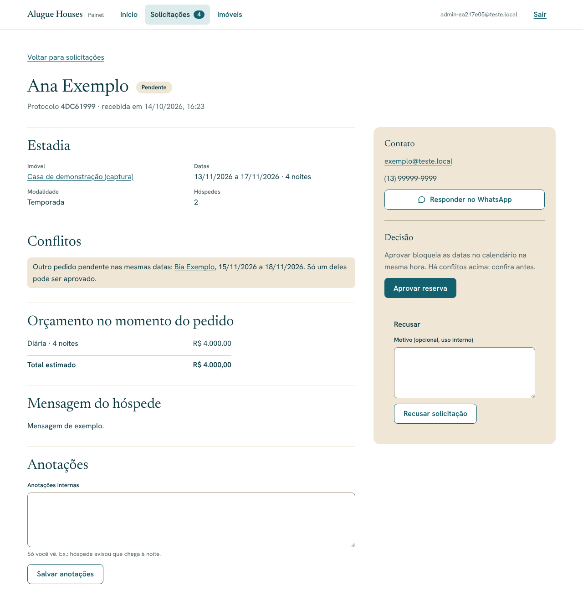
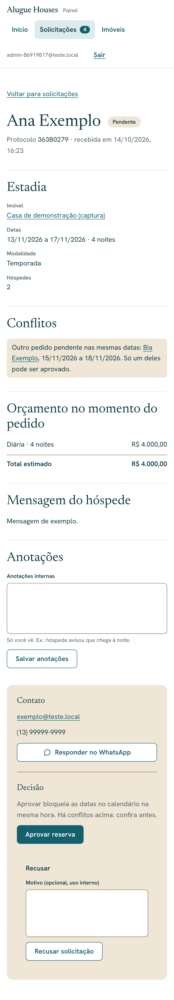

# Alugue Houses — Painel de solicitações, aprovação e bloqueios (Etapa 12)

> Status: **aprovado**.

## Solicitações (`/admin/solicitacoes`)

- Abas: **Pendentes** (padrão, mais antigas primeiro), Aprovadas, Recusadas,
  Canceladas e Todas (mais recentes primeiro).
- Cada linha: hóspede, número de hóspedes, imóvel, datas, noites, modalidade,
  total estimado, situação e quando chegou. Pendentes com chegada no passado
  ganham o aviso "Chegada já passou".
- O menu do painel mostra quantas solicitações estão pendentes; a página
  inicial do painel também.

## Detalhe da solicitação

- Protocolo (o mesmo mostrado ao hóspede), datas, modalidade, hóspedes,
  mensagem e o **orçamento gravado no momento do pedido**.
- **Conflitos** (só em pendentes):
  - períodos já ocupados (reserva aprovada, uso do proprietário ou
    manutenção): aprovar não será possível;
  - outros pedidos pendentes nas mesmas datas, com link: só um pode ser
    aprovado.
- **Contato**: e-mail, telefone e botão "Responder no WhatsApp" com mensagem
  pronta (nome, protocolo, imóvel e datas).
- **Decisão**:
  - **Aprovar**: bloqueia as datas no calendário na mesma transação. Se outro
    pedido já ocupou as datas, o banco recusa e nada muda (testado com
    aprovações simultâneas na Etapa 4). Chegada no passado não pode ser
    aprovada (nova regra no banco).
  - **Recusar** com motivo opcional (fica nas anotações).
  - **Cancelar** uma reserva aprovada (ou pendente) libera as datas.
- **Anotações internas**: só o administrador vê.

## Calendário no editor do imóvel (`/admin/imoveis/[id]#calendario`)

- Lista reservas e bloqueios que ainda não terminaram. Reservas têm link para
  o pedido e só saem cancelando o pedido.
- **Bloquear datas**: motivo (uso do proprietário ou manutenção), primeira e
  última noite (a saída é no dia seguinte) e observação. Sobreposição com
  reserva ou outro bloqueio é recusada pelo banco.
- Remover bloqueio manual libera as datas no site na hora.

## Segurança

- Todas as telas e ações exigem admin com MFA (`requireAdmin`) e usam a sessão
  do admin, sujeita às políticas RLS; nada usa a chave `service_role`.
- Aprovar, recusar e cancelar passam pelas funções do banco
  (`approve_booking_request`, `decline_booking_request`,
  `cancel_booking_request`), que conferem o papel de admin e a situação atual
  do pedido.
- Bloqueios do tipo "reserva" só são criados pela aprovação; a remoção manual
  ignora esse tipo.

## Fora desta etapa

- E-mail automático ao hóspede com a decisão (depende do SMTP/Resend). Por ora
  a resposta é pelo WhatsApp ou e-mail com os links do detalhe.
- Marcar automaticamente como "expirada" a solicitação pendente cuja chegada
  passou (hoje ela aparece com aviso e só pode ser recusada).

## Testes

- **pgTAP** (`10_painel_reservas`): aprovação com chegada no passado recusada,
  recusa com motivo, bloqueio manual, sobreposição recusada, bloqueio de
  reserva sem pedido recusado, hóspede sem acesso ao calendário interno e às
  solicitações. Total do banco: 138.
- **Unitários**: abas, link de WhatsApp do hóspede, validação do bloqueio.
  Total: 72.
- **Ponta a ponta** (desktop, tablet e celular): visitante barrado; lista,
  contador, detalhe, conflitos, aprovar bloqueando as datas no site, segundo
  pedido sem poder ser aprovado, recusa com motivo, cancelamento liberando as
  datas, abas; anotações; bloqueios (validação, criação, sobreposição,
  remoção); WCAG 2.1 AA sem rolagem horizontal. Total da suíte: 194.

