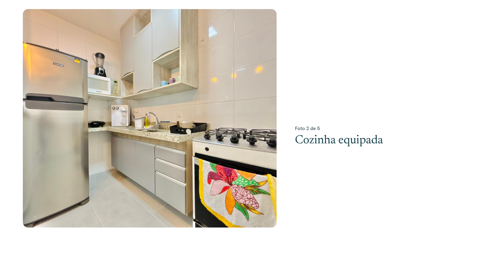
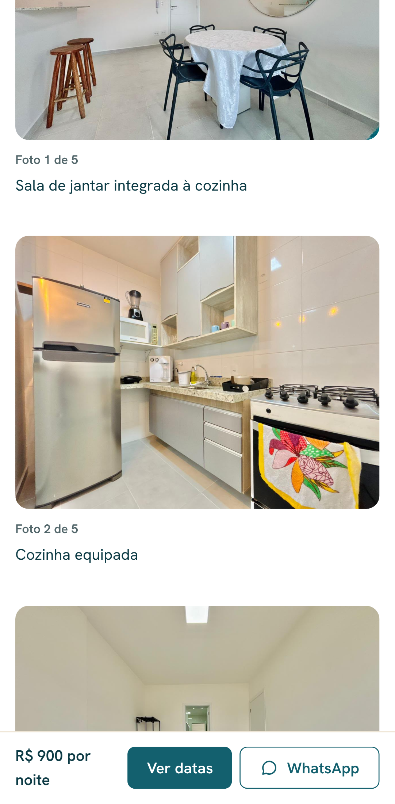

# Alugue Houses — Experiência imersiva "Percorra a casa" (Etapa 16)

> Status: **aprovado**.

## O que é

Seção na página do imóvel (com 3 fotos ou mais), depois dos valores e do
mapa. Conta a casa ambiente por ambiente, na ordem das fotos cadastradas no
painel. As legendas são as **descrições (texto alternativo)** de cada foto:
nada é inventado.

## Como se comporta

| Situação                                         | Comportamento                                                                                                                                            |
| ------------------------------------------------ | -------------------------------------------------------------------------------------------------------------------------------------------------------- |
| Computador (≥ 1024 px), movimento normal         | Foto fixa à esquerda ("palco") trocando com suavidade (0,7 s) conforme a rolagem passa por cada descrição à direita; a descrição ativa fica em destaque. |
| Celular e tablet (< 1024 px)                     | Sequência simples: foto, "Foto N de M" e descrição. Sem efeito.                                                                                          |
| `prefers-reduced-motion: reduce` (qualquer tela) | Mesma sequência simples, sem troca animada.                                                                                                              |
| Sem JavaScript                                   | No computador, o palco mostra a primeira foto e as descrições continuam legíveis.                                                                        |

- Fotos ilustrativas mantêm o aviso "Foto ilustrativa" (no palco e na
  sequência).
- **Acessibilidade**: o palco é decorativo (`aria-hidden`); cada descrição
  aparece uma única vez, como legenda (`figure`/`figcaption`). Destaque da
  etapa ativa por cor, com contraste AA.
- **Desempenho**: imagens com carregamento tardio; as que ficam ocultas em
  cada modo não são baixadas. Sem bibliotecas novas.
- A linha da costa da página inicial já respeitava o movimento reduzido
  (Etapa 7).

## Dica para o painel

A qualidade da seção depende das descrições das fotos. Prefira frases curtas
que digam o ambiente e o destaque, por exemplo: "Sala de jantar integrada à
cozinha", "Suíte com varanda e vista para o mar".

## Fora desta etapa

- **Vídeos e tours 360°**: o banco já tem os tipos (`video`, `tour`), mas o
  painel e o site ainda não. Aguardando a decisão de onde entram.

## Testes

- **Ponta a ponta** com as 5 fotos reais do imóvel 01:
  - computador: palco visível e fixo, troca de foto ao rolar até as etapas 3
    e 5, aviso de foto ilustrativa e "Foto 5 de 5";
  - celular e tablet: sem palco, 5 fotos com legenda;
  - `prefers-reduced-motion`: sem palco e sem troca;
  - imóvel com 2 fotos: seção não aparece;
  - WCAG 2.1 AA (com e sem movimento) e sem rolagem horizontal.
- Total da suíte: 251 aprovados.

