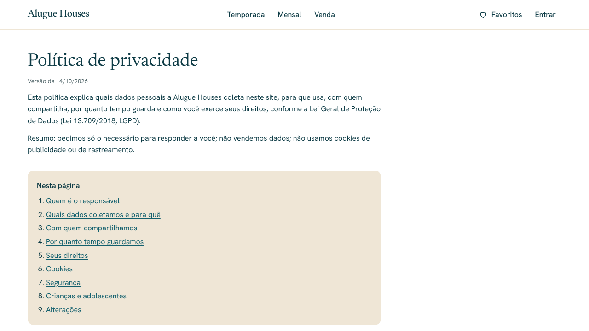

# Alugue Houses — Privacidade e LGPD (Etapa 18)

> Status: **aguardando aprovação**.

> **Importante:** os textos de `/privacidade` e `/termos` foram escritos a
> partir do que o site realmente faz, mas **não substituem a revisão de um
> advogado**, que deve acontecer antes do lançamento.

## Decisões (respostas de 14/10/2026)

| Tema                     | Decisão                                                                                                                                                |
| ------------------------ | ------------------------------------------------------------------------------------------------------------------------------------------------------ |
| Controlador              | Preencher depois. Até lá, os textos mostram "Alugue Houses". Campos em `src/lib/site-config.ts` → `legal.controllerName` e `legal.controllerDocument`. |
| Encarregado (canal LGPD) | `contatoaluguehouses@gmail.com` (`legal.dpoEmail`).                                                                                                    |
| Prazos de guarda         | Reservas: 5 anos após a estadia. Mensagens: 2 anos. Conta e favoritos: até a exclusão. Antispam: 1 dia.                                                |
| Exclusão de conta        | Botão no site, para hóspedes.                                                                                                                          |

## O que foi feito

- **`/privacidade`**: responsável e encarregado; dados por funcionalidade
  (reserva, contato/visita, login, favoritos, avaliações, antispam) com
  finalidade e base legal (art. 7º); compartilhamento (proprietário do
  imóvel e prestadores: Supabase, Cloudflare, Resend, OpenFreeMap) e
  transferência internacional; prazos; direitos do art. 18 com resposta em
  até 15 dias e reclamação à ANPD; cookies; segurança; menores; alterações.
- **`/termos`**: reserva por solicitação (não vinculante, valor estimado,
  nada cobrado pelo site, pagamento e cancelamento informados na
  confirmação); imóveis de terceiros, fotos ilustrativas e localização
  aproximada; venda com profissional habilitado; conta; regras de
  moderação das avaliações; uso adequado; lei brasileira e CDC.
- **Links**: consentimento dos formulários de reserva, contato e visita
  (abrem em nova aba para não perder o que foi digitado); login ("Ao entrar,
  você concorda…"); envio de avaliação; rodapé; sitemap.
- **Cookies**: só essenciais (sessão de login e retorno após o link). Por
  isso **não há banner de cookies** — se um dia entrar analytics ou
  publicidade, será preciso pedir consentimento.
- **Excluir minha conta** (página Entrar, hóspede conectado): exige marcar a
  confirmação; apaga login, perfil, favoritos e avaliações (exclusão em
  cascata no banco); sai da sessão e mostra "Sua conta foi excluída".
  Solicitações de reserva ficam pelo prazo de guarda. Administradores não
  veem a opção (e a ação recusa).
- **Limpeza automática diária** (pg_cron, 03:17 de Brasília):
  `private.purge_expired_personal_data()` apaga mensagens com mais de 2 anos
  e solicitações cuja estadia terminou há mais de 5 anos (com bloqueios do
  calendário e avaliações ligados a elas). No Supabase de produção, a
  extensão `pg_cron` é ativada pela própria migration.

## Antes do lançamento (lista de verificação)

- [ ] Informar o controlador (nome e CPF, ou razão social e CNPJ).
- [ ] Revisão jurídica dos dois textos, incluindo:
  - confirmar que dados podem ser repassados ao proprietário do imóvel e
    em quais casos;
  - avaliar a guarda de registros de acesso exigida do provedor de
    aplicação pelo Marco Civil da Internet (art. 15, 6 meses), conforme o
    enquadramento da empresa;
  - confirmar os prazos de guarda e o foro.
- [ ] Atualizar `legal.updatedAt` a cada nova versão dos textos.

## Testes

- **pgTAP** (`13_retencao`): apaga só o que passou do prazo (reserva de 5
  anos e 1 dia e seus bloqueios; mensagem de 2 anos e 1 dia), mantém as
  recentes, agendamento diário criado, visitante não executa a limpeza.
  Total do banco: 163.
- **Ponta a ponta** (desktop, tablet e celular): conteúdo e navegação das
  páginas; links no rodapé, na reserva (nova aba), no contato e no login;
  exclusão de conta (confirmação obrigatória, login e favoritos apagados,
  reserva mantida); administrador sem a opção; WCAG 2.1 AA sem rolagem
  horizontal. Total da suíte: 287.

Ajuste visual junto: "Minhas estadias" agora usa a mesma coluna de leitura
das páginas legais (antes ocupava a largura toda no computador).
