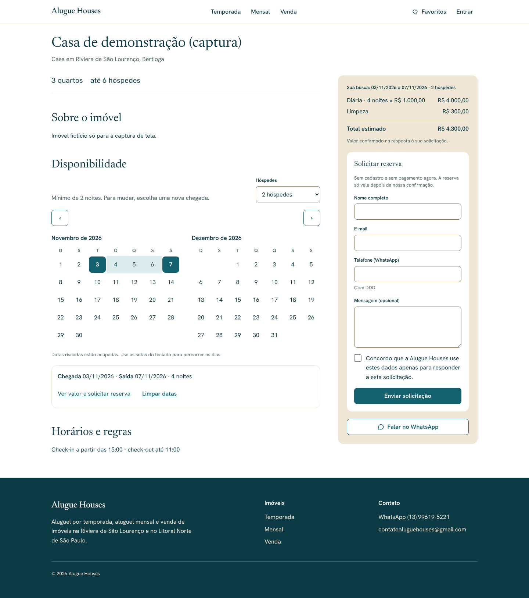
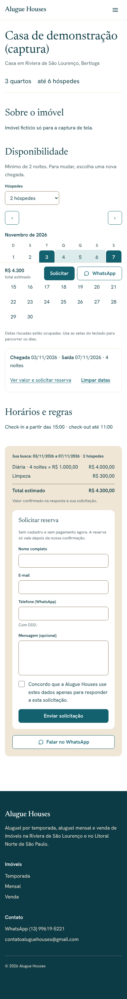

# Alugue Houses — Calendário e solicitação de reserva (Etapa 11)

> Status: **aguardando aprovação**.

## Calendário de disponibilidade

Seção "Disponibilidade" na página do imóvel (só quando ele oferece temporada
ou mensal).

- Mostra **um ano** a partir de hoje (fuso de São Paulo): 2 meses lado a lado
  a partir de 768 px, 1 mês no celular.
- **Noites ocupadas** (reservas aprovadas e bloqueios) aparecem riscadas e
  não podem ser escolhidas. O motivo do bloqueio nunca chega ao navegador
  (`get_unavailable_ranges`).
- Primeiro clique escolhe a **chegada**; o segundo, a **saída**. Sair no dia
  em que outra estadia começa é permitido.
- Limites de noites conforme as modalidades: só temporada = mínimo do imóvel
  até 29; só mensal = 30 até o máximo; as duas = mínimo até o máximo
  (30 noites ou mais viram aluguel mensal). Tarifas sazonais com mínimo maior
  são conferidas pelo banco e explicadas no painel.
- Ao escolher a saída, o endereço vira `?chegada=…&saida=…&hospedes=…` e o
  painel recalcula o total com o mesmo orçamento da Etapa 10.
- **Acessibilidade**: tabela com cabeçalhos dos dias da semana; cada dia diz a
  data completa e o estado ("chegada", "saída", "ocupado", "indisponível");
  dias indisponíveis continuam focáveis (`aria-disabled`); setas, Home/End e
  PageUp/PageDown percorrem os dias; mudanças anunciadas em região `status`;
  áreas de toque de 44 px.

## Solicitação de reserva

Aparece no painel "Valores e contato" quando as datas têm total válido.

- **Sem conta**: nome, e-mail, telefone (com DDD; aceita máscara e +55),
  mensagem opcional e **consentimento** obrigatório (LGPD: dados usados só
  para responder à solicitação).
- Envio por **Server Action**: validação zod → anti-robô → limite de envios →
  `request_booking` (só `service_role`). O banco recalcula o orçamento, confere
  publicação, data passada e calendário; o total é gravado como foto do
  orçamento (`quote_snapshot`).
- Resultado: tela "Solicitação enviada" com **protocolo** (8 primeiros
  caracteres do id), aviso de que ainda não é reserva confirmada e de que nada
  foi cobrado. Fica **pendente** até a aprovação manual (Etapa 12). Pedidos
  pendentes podem se sobrepor; a garantia contra overbooking está na
  aprovação (restrição de exclusão no banco).
- Erros mantêm o que foi digitado.

## Anti-spam

| Camada               | Como funciona                                                           |
| -------------------- | ----------------------------------------------------------------------- |
| Campo-isca           | Campo invisível; se vier preenchido, responde "enviada" sem gravar.     |
| Limite por IP        | 5 envios por hora. No Cloudflare usa `cf-connecting-ip` (não forjável). |
| Limite por e-mail    | 5 envios por dia.                                                       |
| Cloudflare Turnstile | Ativo quando as chaves estão configuradas (abaixo).                     |

O limite fica no banco (`private.rate_limit_hits`, função `hit_rate_limit`),
porque o Workers não tem memória compartilhada. IP e e-mail são gravados
apenas como **HMAC-SHA256** (chave = `SUPABASE_SERVICE_ROLE_KEY`); registros
com mais de um dia são apagados automaticamente. Se o banco falhar, o envio é
recusado.

### Configurar o Turnstile (antes de publicar)

1. No painel da Cloudflare: **Turnstile → Add widget**, domínio do site, modo
   "Managed".
2. Nos segredos do Worker: `NEXT_PUBLIC_TURNSTILE_SITE_KEY` (pública) e
   `TURNSTILE_SECRET_KEY` (secreta).
3. Sem a chave secreta o formulário funciona sem essa camada e o servidor
   registra um aviso. Para testar localmente, a Cloudflare publica
   [chaves de teste](https://developers.cloudflare.com/turnstile/troubleshooting/testing/).
4. Na Etapa 17 (CSP), liberar `challenges.cloudflare.com` em `script-src` e
   `frame-src`.

Nenhuma chave foi criada ou versionada nesta etapa.

## Fora desta etapa

- **Aviso por e-mail** ao administrador e ao hóspede: depende do SMTP
  (Resend) configurado; até lá, as solicitações ficam no banco e aparecerão
  no painel na Etapa 12.
- Painel de solicitações, aprovação, recusa e bloqueios manuais: Etapa 12.
- Link para a política de privacidade no consentimento: Etapa 18.
- Expiração automática de pedidos pendentes cujas datas já passaram.

## Testes

- **pgTAP** (`09_limite_envios`): cota por remetente, tentativas recusadas não
  contam, janela inválida, visitante sem acesso à função e à tabela.
  Total do banco: 130 testes.
- **Unitários**: regras do calendário (noites, ocupação `[início, fim)`,
  chegada, saída, limites por modalidade, montagem dos meses), validação do
  formulário, IP e hash, Turnstile (desativado, token ausente, válido,
  inválido, falha de rede). Total: 69.
- **Ponta a ponta** (desktop, tablet e celular): noites ocupadas, escolha das
  datas com total e formulário, saída que atravessa bloqueio, teclado, erros
  mantendo o que foi digitado, envio gravando pendente com orçamento e
  protocolo, campo-isca, limite por IP, barra do celular e WCAG 2.1 AA sem
  rolagem horizontal. Total da suíte: 179 aprovados.

